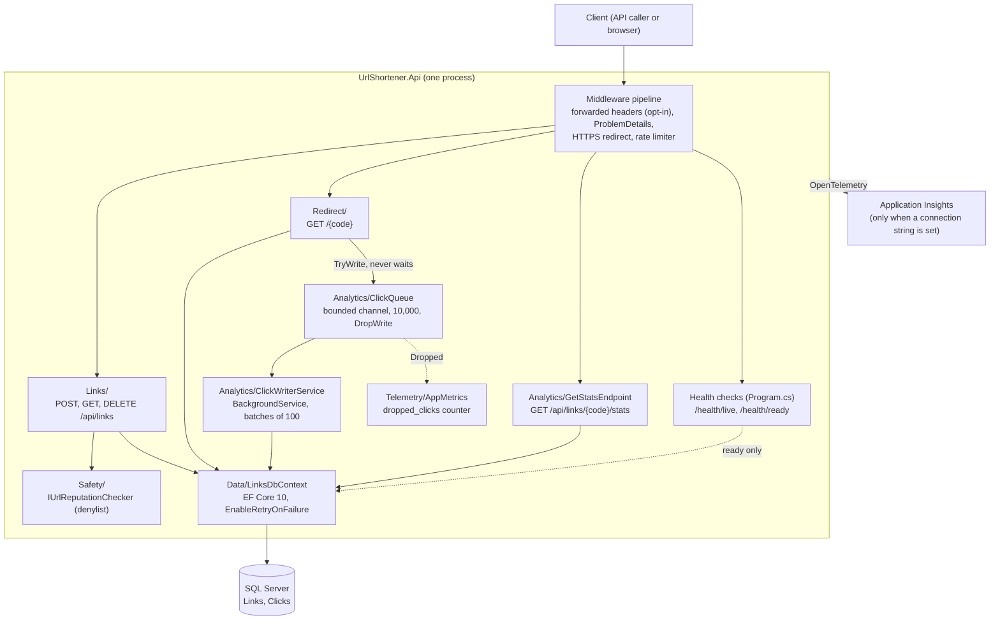
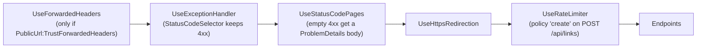
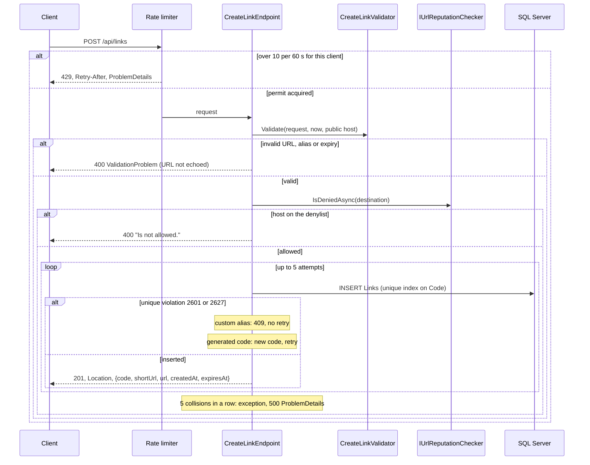
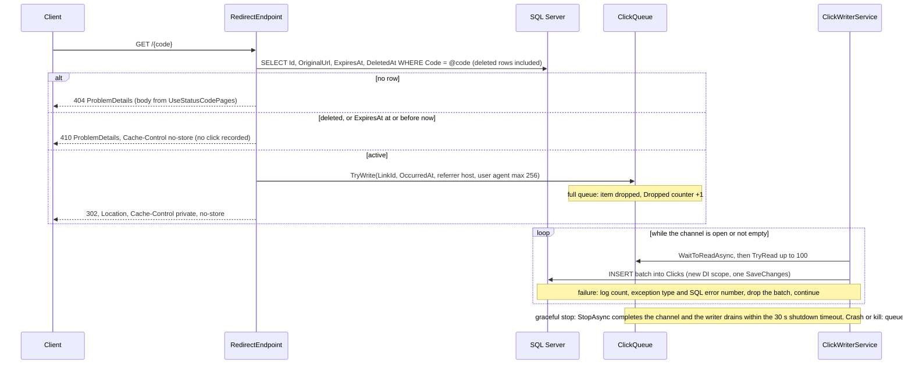
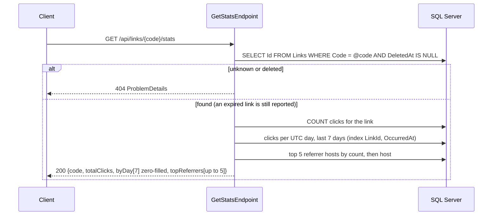
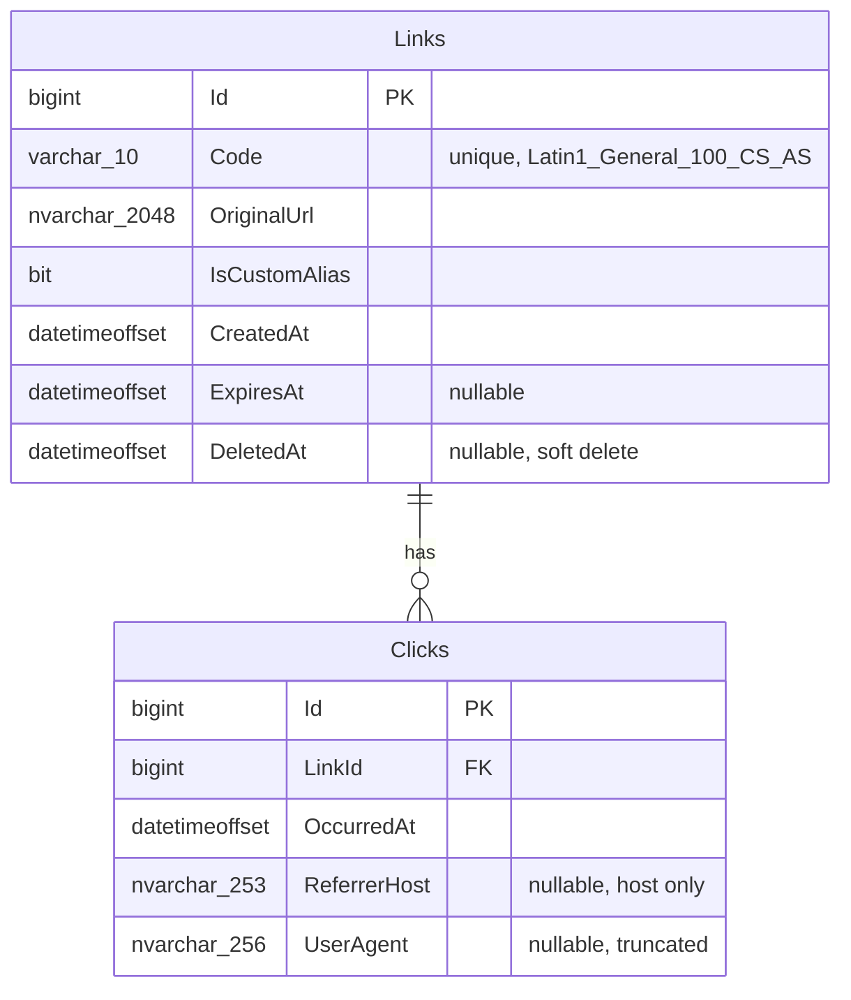
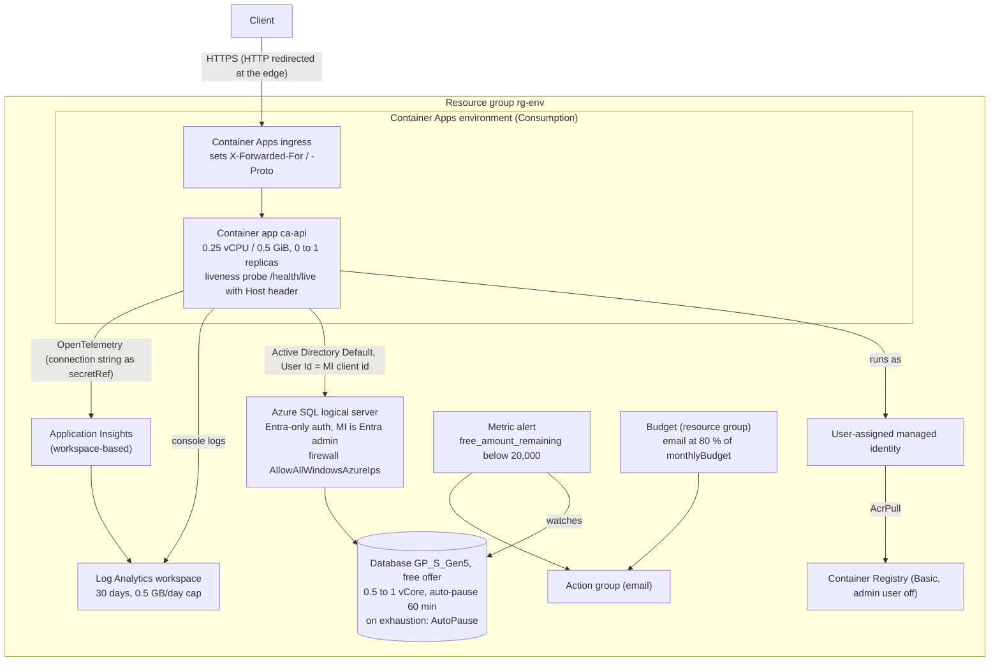

# Architecture

One ASP.NET Core Minimal API process (.NET 10) with one SQL Server database, run locally with `docker compose` and in Azure on Container Apps with the Azure SQL free offer. Every element below links to the decision record that explains it; this page describes the shape, not the reasons. The engineering system around it (tools and execution approach) is summarised [at the end](#tools-and-execution-approach); the evidence is in [`ENGINEERING_SUMMARY.md`](ENGINEERING_SUMMARY.md).

Contents: [components](#components) · [request pipeline](#request-pipeline) · [create](#create-a-link) · [redirect and click write](#redirect-and-click-write) · [stats](#stats) · [data model](#data-model) · [Azure deployment](#azure-deployment) · [cross-cutting](#cross-cutting-concerns) · [tools and execution approach](#tools-and-execution-approach) · [decision index](#decision-index)

## Components

| Component | Code | Role | Decision |
|---|---|---|---|
| Create, get, delete | [`Links/`](../src/UrlShortener.Api/Links/) | Validate the destination and alias, insert with retry on a unique violation, read metadata, soft delete in one `UPDATE` | [ADR-0002](adr/0002-short-codes-and-collation.md), [ADR-0007](adr/0007-expiry-and-safety.md) |
| Short-code generator | [`Links/ShortCode.cs`](../src/UrlShortener.Api/Links/ShortCode.cs) | 7-character Base62 from `RandomNumberGenerator.GetString`; injected as a delegate so tests can force collisions | [ADR-0002](adr/0002-short-codes-and-collation.md) |
| Destination validation | [`Links/CreateLinkValidator.cs`](../src/UrlShortener.Api/Links/CreateLinkValidator.cs) | Pure function: length 2048, printable ASCII, http/https, host, no user info, non-public IP literals, `localhost`, own host, reserved aliases | [ADR-0007](adr/0007-expiry-and-safety.md) |
| Reputation seam | [`Safety/`](../src/UrlShortener.Api/Safety/) | `IUrlReputationChecker`; default is the `Safety:DeniedHosts` denylist, no network call | [ADR-0007](adr/0007-expiry-and-safety.md) |
| Redirect | [`Redirect/RedirectEndpoint.cs`](../src/UrlShortener.Api/Redirect/RedirectEndpoint.cs) | One lookup; 302, 404 or 410; enqueue a click on 302 only | [ADR-0003](adr/0003-redirect-semantics.md), [ADR-0007](adr/0007-expiry-and-safety.md) |
| Click queue and writer | [`Analytics/ClickQueue.cs`](../src/UrlShortener.Api/Analytics/ClickQueue.cs), [`ClickWriterService.cs`](../src/UrlShortener.Api/Analytics/ClickWriterService.cs) | In-memory hand-off from the redirect; batch insert in the background; drain on graceful shutdown | [ADR-0004](adr/0004-async-click-analytics.md) |
| Stats | [`Analytics/GetStatsEndpoint.cs`](../src/UrlShortener.Api/Analytics/GetStatsEndpoint.cs) | Total, 7 UTC days, top 5 referrer hosts | [ADR-0004](adr/0004-async-click-analytics.md), [brownfield scenario](scenarios/brownfield.md) |
| Rate limiter | [`Program.cs`](../src/UrlShortener.Api/Program.cs), [`RateLimiting/RateLimitOptions.cs`](../src/UrlShortener.Api/RateLimiting/RateLimitOptions.cs) | Fixed window per client IP on `POST /api/links` only; 429 + `Retry-After` + ProblemDetails | [ADR-0005](adr/0005-rate-limiting.md) |
| Public URL and proxy trust | [`PublicUrl/PublicUrlOptions.cs`](../src/UrlShortener.Api/PublicUrl/PublicUrlOptions.cs) | `shortUrl` from configuration, never from `Host`; forwarded headers only when switched on | [ADR-0005, "Resolution (#9)"](adr/0005-rate-limiting.md#resolution-9) |
| Persistence | [`Data/LinksDbContext.cs`](../src/UrlShortener.Api/Data/LinksDbContext.cs), [`Migrations/`](../src/UrlShortener.Api/Migrations/) | EF Core 10 on SQL Server; case-sensitive `Code` column; startup migration behind a switch | [ADR-0001](adr/0001-stack-and-database.md), [ADR-0006](adr/0006-azure-hosting-and-migrations.md) |
| Telemetry | [`Telemetry/AppMetrics.cs`](../src/UrlShortener.Api/Telemetry/AppMetrics.cs), [`Program.cs`](../src/UrlShortener.Api/Program.cs) | Azure Monitor OpenTelemetry distro, opt-in by connection string; one app metric plus the built-in rate-limiting meter | [ADR-0006, "Telemetry"](adr/0006-azure-hosting-and-migrations.md#telemetry-b7-28) |

Health checks have no folder: they are two `MapHealthChecks` lines in `Program.cs`.

## Request pipeline

Order as registered in [`Program.cs`](../src/UrlShortener.Api/Program.cs):

- Before the app listens: `MigrateAsync` when `Database:MigrateOnStartup` is true (Development and Azure), so no request sees an old schema ([ADR-0006](adr/0006-azure-hosting-and-migrations.md)).
- Forwarded headers first, so the rate limiter and HTTPS redirect see the client's IP and scheme. Rate limiter after the HTTPS redirect, so an `http://` POST that gets a 307 does not spend a permit (code review, [AI log 010](ai-log/010-rate-limit.md)).
- OpenAPI (`/openapi/v1.json`) and Scalar (`/scalar`) are mapped in Development only.
- Host filtering (`AllowedHosts`) is the framework default middleware: `*` in `appsettings.json`, `localhost` in `appsettings.Production.json` (fails closed), the app's FQDN in Bicep.

## Create a link

`POST /api/links {url, customAlias?, expiresAt?}` ([`CreateLinkEndpoint.cs`](../src/UrlShortener.Api/Links/CreateLinkEndpoint.cs)).

- Uniqueness is decided by the unique index, never by a check before the insert ([ADR-0002](adr/0002-short-codes-and-collation.md)).
- The log line holds the code and the destination host only.

## Redirect and click write

`GET /{code}` with route constraint `^[A-Za-z0-9]{4,10}$` ([`RedirectEndpoint.cs`](../src/UrlShortener.Api/Redirect/RedirectEndpoint.cs)); the writer is [`ClickWriterService.cs`](../src/UrlShortener.Api/Analytics/ClickWriterService.cs).

- The redirect never waits on the queue or the insert, so a database problem in the writer cannot change a redirect's status or headers ([ADR-0004](adr/0004-async-click-analytics.md)).
- Delivery is at most once; stats are eventually consistent ([TESTING.md, "Known limitations"](TESTING.md#known-limitations)).
- An idle writer waits on the channel, not on a timer, so it opens no connection and Azure SQL can auto-pause.
- The click insert runs outside the request, so in Application Insights it is a separate operation, not linked to the redirect trace (ADR-0006, "Known limitation").

## Stats

`GET /api/links/{code}/stats` ([`GetStatsEndpoint.cs`](../src/UrlShortener.Api/Analytics/GetStatsEndpoint.cs)).

Four small queries rather than one combined query ([AI log 009](ai-log/009-stats.md)).

## Data model

From the migrations [`InitialCreate`](../src/UrlShortener.Api/Migrations/20261010213557_InitialCreate.cs) and [`AddClicks`](../src/UrlShortener.Api/Migrations/20261011001449_AddClicks.cs).

- **Collation.** `Code` is `varchar(10) COLLATE Latin1_General_100_CS_AS` at column level, so the unique index itself is case-sensitive. SQL Server's default (`SQL_Latin1_General_CP1_CI_AS`) would make `abc` and `ABC` collide; the red run is in [AI log 002](ai-log/002-persistence.md) ([ADR-0002](adr/0002-short-codes-and-collation.md)).
- **Indexes.** `IX_Links_Code` (unique); `IX_Clicks_LinkId_OccurredAt` for the per-link, per-day stats.
- **No client IP is stored** ([ADR-0004](adr/0004-async-click-analytics.md); brownfield open question 2).
- **Soft delete only.** The FK keeps EF's default cascade, which no code path can reach while deletes are soft ([AI log 008](ai-log/008-click-analytics.md)). Rows are never purged and codes are never reused ([ADR-0007](adr/0007-expiry-and-safety.md)).
- **Migrations only add** so far, which matters for the rollout rule below.

## Azure deployment

`azd up` provisions [`infra/main.bicep`](../infra/main.bicep) (subscription scope: one resource group) and [`infra/resources.bicep`](../infra/resources.bicep) (everything else), builds [`Dockerfile`](../src/UrlShortener.Api/Dockerfile) locally and pushes it. Decisions: [ADR-0006](adr/0006-azure-hosting-and-migrations.md). Usage: [SETUP.md, "Deploy to Azure"](SETUP.md#deploy-to-azure).

| Element | Configuration | Why (ADR-0006 unless stated) |
|---|---|---|
| Container app | `minReplicas 0`, `maxReplicas 1`, `activeRevisionsMode Single` | Scale to zero for idle cost; one replica because the rate limiter is in memory ([ADR-0005](adr/0005-rate-limiting.md)) and the startup migration assumes one instance |
| Probes | Liveness only, `GET /health/live`, `Host: <fqdn>` header; Container Apps adds default TCP startup/readiness probes | A probe that queries the database would keep the free-offer database online |
| App settings | `ASPNETCORE_ENVIRONMENT=Production`, `PublicUrl__BaseUrl=https://<fqdn>`, `PublicUrl__TrustForwardedHeaders=true`, `AllowedHosts=<fqdn>`, `Database__MigrateOnStartup=true`, `OTEL_TRACES_SAMPLER=microsoft.fixed_percentage` with arg `1.0`, query redaction re-enabled | Each is explained in ADR-0006; sampling in #33 ([AI log 016](ai-log/016-trace-sampling.md)) |
| Identity | One user-assigned identity: the app's identity, the registry pull identity and the SQL Entra admin | `azd up` needs no manual SQL step. Trade-off: the app is `db_owner` |
| SQL network | Public endpoint + the `0.0.0.0` "Allow Azure services" rule | Consumption has no fixed outbound IP; Entra-only auth keeps other Azure tenants out |
| Image on first provision | Placeholder image until `azd deploy`; [`infra/api-image.bicep`](../infra/api-image.bicep) reads the current image on later provisions | Inline lookup was a circular dependency in ARM (#31, [AI log 015](ai-log/015-sql-autopause-default.md)) |
| Cost guardrails | Free-offer `AutoPause` on exhaustion (hard stop), free-amount alert, resource-group budget (default 10) | Alerts only notify; the auto-pause is the stop |

**Rollout window.** `maxReplicas: 1` bounds steady state, not a deployment: the old revision serves until the new one is ready, while the new container migrates. Rule: migrations shipped with `azd deploy` must be backward-compatible with the previous image (expand/contract). Found by code review in B6 ([AI log 013](ai-log/013-azure-infra.md)).

Deployed and verified live in centralus on 2026-10-11: create, redirect, stats and readiness ([AI log 015](ai-log/015-sql-autopause-default.md)), telemetry checks ([AI log 014](ai-log/014-telemetry.md)), every ADR-0007 rule and both 410 paths ([AI log 019](ai-log/019-expiry-safety.md)).

## Cross-cutting concerns

### Errors: ProblemDetails everywhere
`AddProblemDetails()`, an unconditional `UseExceptionHandler` with a `StatusCodeSelector` (keeps a `BadHttpRequestException`'s 4xx in Development) and `UseStatusCodePages()` (gives empty 4xx such as `TypedResults.NotFound()` a body). Every error is `application/problem+json` with a `traceId`, in every environment, without stack traces (`ProductionErrorPipelineTests`; [AI log 005](ai-log/005-api-surface.md); CLAUDE.md §9).

### Logging and telemetry
- The app's own log lines carry the short code, the destination **host**, counts, exception type and SQL error number. Never the destination URL, the referrer path or a client IP (CLAUDE.md §7). `[LoggerMessage]` source-generated methods (CA1848 is an error).
- EF Core SQL command logging is at `Warning` (#25, [AI log 013](ai-log/013-azure-infra.md)).
- Telemetry is opt-in by `APPLICATIONINSIGHTS_CONNECTION_STRING`; local runs and tests export nothing. Every trace is kept, so a `traceId` returned in an error body is always findable ([AI log 016](ai-log/016-trace-sampling.md)). Query strings are stored as `Redacted`; App Insights stores the client IP as `0.0.0.0`; `/health/*` is not traced ([ADR-0006, "Telemetry"](adr/0006-azure-hosting-and-migrations.md#telemetry-b7-28)).

### Health probes
| Endpoint | Checks | Used by |
|---|---|---|
| `/health/live` | Nothing (`Predicate = _ => false`): never opens a connection | Container Apps liveness probe |
| `/health/ready` | `AddDbContextCheck<LinksDbContext>` | Manual checks only; no probe, so the database can auto-pause |

`LiveDoesNotTouchTheDatabase` proves the first with an unreachable database (mutation-checked, [AI log 005](ai-log/005-api-surface.md)).

### Configuration and options
All options are bound with `BindConfiguration` and validated at startup (`ValidateOnStart`): a bad value stops the app instead of failing at the first request.

| Key | Default | Set where | Validation |
|---|---|---|---|
| `ConnectionStrings:UrlShortener` | none | `dotnet user-secrets` locally; Bicep env var (passwordless) in Azure | Explicit error at startup when migrating without it |
| `PublicUrl:BaseUrl` | none (required) | `appsettings.Development.json`; Bicep | Raw string: printable ASCII, absolute http/https, no user info, path, query or fragment |
| `PublicUrl:TrustForwardedHeaders` | `false` | Bicep (`true`) | bool |
| `RateLimiting:PermitLimit` / `WindowSeconds` | 10 / 60 | code defaults (single source) | `[Range]` |
| `Safety:DeniedHosts` | empty | configuration | plain ASCII host names only |
| `Database:MigrateOnStartup` | `false` | `appsettings.Development.json`; Bicep (`true`) | bool |
| `AllowedHosts` | `*`; `localhost` in Production | Bicep (the FQDN) | framework |
| `APPLICATIONINSIGHTS_CONNECTION_STRING` | unset (no telemetry) | Bicep, as a Container Apps secret | presence check |

### Security boundaries
| Boundary | Control | Source |
|---|---|---|
| Anonymous API | **No authentication** on any endpoint, including `DELETE` and `/stats` (a recorded assumption: internal/demo). Create is rate-limited | [`plan.md`](plan.md) "API surface"; surfaced by the security review in [AI log 013](ai-log/013-azure-infra.md) |
| Destination URL (user input that becomes a `Location` header) | Validated on the raw string; non-public IP literals, `localhost`, own host and denylisted hosts rejected; no DNS lookup, no fetch | [ADR-0007](adr/0007-expiry-and-safety.md) |
| `Host` and `X-Forwarded-*` headers | `shortUrl` never uses `Host`; host filtering fails closed in Production; forwarded headers trusted only when switched on (only behind the Container Apps ingress) | [ADR-0005 "Resolution (#9)"](adr/0005-rate-limiting.md#resolution-9), [AI log 011](ai-log/011-public-base-url.md) |
| Database access | Entra-only, managed identity, no password anywhere; parameterised EF queries | [ADR-0006](adr/0006-azure-hosting-and-migrations.md) |
| Personal data | No IP stored; referrer reduced to its host; user agent truncated; no URLs or IPs in logs or telemetry | [ADR-0004](adr/0004-async-click-analytics.md), ADR-0006 "Telemetry" |
| Container | Non-root user (`USER $APP_UID`), SDK image pinned to 10.0.101 | [AI log 013](ai-log/013-azure-infra.md) |

## Tools and execution approach

The application above is half the deliverable; the other half is the system that produced it. Each tool has one job, and the engineer is the only one who merges.

| Tool | Role | Where it is configured |
|---|---|---|
| GitHub issues | Each task: intent, constraints, acceptance criteria, technical context, risk level | [issue template](../.github/ISSUE_TEMPLATE/task.md) |
| Claude Code, coordinator session | Plans, briefs subagents, reviews every diff, re-runs gates, triages reviews, commits, opens PRs; never merges or pushes to `main` | [`CLAUDE.md`](../CLAUDE.md) §6 |
| Claude Code, subagents | One fresh agent per issue on its own branch: implements test first where it matters, writes the AI log, reports decisions back instead of guessing; never commits | `CLAUDE.md` §6.12 |
| `/security-review`, fresh-context `/code-review` | Independent agents on the committed diff of every high-impact change | `CLAUDE.md` §6.6 |
| `CLAUDE.md` | Rules, conventions and §9 gotchas: memory that every session and subagent reads first | [`CLAUDE.md`](../CLAUDE.md) |
| `.claude/settings.json` | Deny rules for secret files; Stop hook that runs the Release build and unit tests before a session can end; no attribution trailers | [`.claude/settings.json`](../.claude/settings.json) |
| AI logs, HANDOFF | Traceability (generated / edited / rejected with reasons, real check output) and a cold-start handoff between sessions and models | [`ai-log/`](ai-log/), [`HANDOFF.md`](HANDOFF.md) |
| Compiler and analyzers | Warnings as errors, `latest-recommended`, code style enforced in build, NuGet audit | [`Directory.Build.props`](../Directory.Build.props), [`.editorconfig`](../.editorconfig) |
| GitHub Actions | `build-test` (build, format, tests on real SQL Server, vulnerable packages, coverage) and `bicep` (pinned lint, fails on warnings) | [`ci.yml`](../.github/workflows/ci.yml) |
| Testcontainers, k6 | Integration tests against real SQL Server; load tests from Docker | [`TESTING.md`](TESTING.md) |
| `azd` + Bicep, Application Insights | Reproducible deploy and teardown; live verification after each deploy | [`infra/`](../infra/), [`SETUP.md`](SETUP.md#deploy-to-azure) |

**Control flow of one change:** issue → branch → subagent (tests first) → coordinator review and gates → security and code review if high-impact → PR with walkthrough and pasted output → CI → engineer reads, signs off, merges → deploy and live check where it applies. The loop diagram and how it held up are in the [engineering summary](ENGINEERING_SUMMARY.md#how-ai-was-used-and-governed).

## Decision index

| ADR | Decision | Status |
|---|---|---|
| [0001](adr/0001-stack-and-database.md) | .NET 10 Minimal APIs, EF Core 10, SQL Server as the only provider | accepted |
| [0002](adr/0002-short-codes-and-collation.md) | Random 7-character Base62, case-sensitive column collation, insert and retry | accepted |
| [0003](adr/0003-redirect-semantics.md) | 302 + `Cache-Control: private, no-store` | accepted; superseded in part by 0007 |
| [0004](adr/0004-async-click-analytics.md) | Bounded channel + background batch writer; at-most-once clicks | accepted |
| [0005](adr/0005-rate-limiting.md) | Fixed window per IP on create, 10 per 60 s, 429 + `Retry-After` | proposed |
| [0006](adr/0006-azure-hosting-and-migrations.md) | Container Apps + Azure SQL free offer via azd; startup migration; telemetry | proposed |
| [0007](adr/0007-expiry-and-safety.md) | Expired and deleted → 410; create-time safety rules + reputation seam | proposed |
