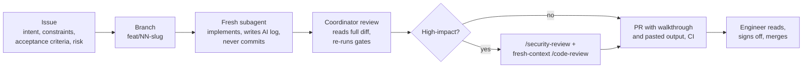

# Engineering summary

A URL shortener built as a three-day take-home (work logged on 2026-10-10 and 2026-10-11) as an exercise in **engineer-led, AI-accelerated** delivery: Claude Code wrote most of the code, tests and docs inside scoped tasks; the engineer set the plan, answered the decisions that change behaviour, reviewed and merged every PR. This page summarises what was built, how the AI work was governed, what the reviews caught, the evidence, and what is left. Every claim links to its source; the AI logs in [`docs/ai-log/`](ai-log/) are the record.

Contents: [what was built](#what-was-built) · [how AI was used and governed](#how-ai-was-used-and-governed) · [generated, edited, rejected](#generated-edited-rejected-examples) · [what the reviews caught](#what-the-reviews-caught) · [quality gates and evidence](#quality-gates-and-evidence) · [performance](#performance) · [limitations and trade-offs](#limitations-and-trade-offs) · [next for production](#what-would-come-next-for-production) · [pending](#pending-engineer-actions)

## Plan and rationale

The plan ([`plan.md`](plan.md)) was written and approved before any code, after a research pass that checked the design's claims against primary sources ([research report](research/reports/URL%20shortener%20assignment%20validation.md)). Its main calls, each now an ADR:

- **SQL Server everywhere** (Testcontainers, `docker compose`, Azure SQL free offer), not SQLite locally: the case-insensitive default collation is the main domain risk, and only the real engine shows it ([ADR-0001](adr/0001-stack-and-database.md), [ADR-0002](adr/0002-short-codes-and-collation.md)). Cost: the reviewer needs Docker.
- **TDD only where a bug would be expensive:** short codes and collation, destination validation, redirect status and headers, 429 + `Retry-After`, expiry → 410 (CLAUDE.md §7).
- **Ambiguities not pre-decided.** Expiry and "safe" were left open on Day 1 and became the ambiguous scenario.

Architecture: [`ARCHITECTURE.md`](ARCHITECTURE.md). Run it: [`SETUP.md`](SETUP.md). Tests: [`TESTING.md`](TESTING.md).

## What was built

| Scenario | Issues → PRs | Result | Write-up |
|---|---|---|---|
| **Greenfield** (Day 1): core create/redirect service | G1–G6: #1–#6 → PRs #7, #8, #10, #11, #12, #13 | Solution with quality gates and CI; `POST /api/links` (Base62 codes, custom alias, validation, retry on collision); `GET /{code}` 302 + `private, no-store`; get, soft delete, health, OpenAPI/Scalar, ProblemDetails. 72 tests | [greenfield.md](scenarios/greenfield.md) |
| **Brownfield** (Day 2): analytics, rate limiting, Azure on the working service | B1–B7 and fixes: #14–#19, #9, #25, #28, #31, #33, #44 → PRs #20, #22, #23, #24, #26, #27, #29, #30, #32, #34, #35, #45 | Impact analysis first; click analytics through a bounded channel and background writer; stats; rate limit on create; measured no-cache decision; configured public base URL and opt-in forwarded headers; Azure infra with `azd` + Bicep; OpenTelemetry to Application Insights; three first-deploy failures fixed; trace sampling fixed; a support workbook (find a request by `traceId`, redirect outcomes, 429s, health). 101 tests | [brownfield.md](scenarios/brownfield.md) |
| **Ambiguous** (Day 3): "links should expire and be safe" | A1 #36 → PR #37, A2 #38 → PR #39, A4 #40 → PR #41; A3 folded into [Performance](#performance) | Ten questions, four answered by the engineer, the rest recorded as reversible assumptions; expired and deleted → 410 + `no-store`; create-time rules against non-public IP literals, `localhost`, the service's own host, reserved aliases; a reputation seam with a host denylist. 199 tests | [ambiguous.md](scenarios/ambiguous.md) |

Running: locally ([`SETUP.md`](SETUP.md)) and on Azure (centralus) since 2026-10-11, verified live after each deploy ([AI log 015](ai-log/015-sql-autopause-default.md), [014](ai-log/014-telemetry.md), [016](ai-log/016-trace-sampling.md), [019](ai-log/019-expiry-safety.md), [021](ai-log/021-workbook.md)). 25 PRs merged (the last two, #46 and #47, docs follow-ups; #47 put the live URL and the support scenario in the README); open: #21 (deferred).

**Assumptions** recorded rather than asked: no authentication (internal/demo, [`plan.md`](plan.md)); no click retention; links immutable; expired rows kept and codes never reused ([ambiguous.md](scenarios/ambiguous.md), questions 6–9); one replica.

## How AI was used and governed

### The loop

| Element | What it is | Where |
|---|---|---|
| Issue first | Every task an issue with intent, constraints, acceptance criteria and risk level; labels `scenario:*`, `type:*`, `risk:high-impact` | `gh issue list`; [template](../.github/ISSUE_TEMPLATE/task.md) |
| One subagent per issue | Briefed with the issue, CLAUDE.md and the AI-log template; reports decisions back instead of guessing | CLAUDE.md §6.12 |
| Coordinator review | A separate session reads the whole diff, re-runs the gates, triages review findings; recorded as a "Coordinator review" table in each AI log | e.g. [AI log 013](ai-log/013-azure-infra.md#coordinator-review) |
| Reviews on high-impact work | Schema, URL validation, rate-limit policy, infra, agent settings, secrets: `/security-review` and a fresh-context `/code-review` before the PR | CLAUDE.md §6.6 |
| Engineer ownership | Engineer answers the questions that change behaviour (B1: 8, three asked explicitly and five accepted on the recommendation; A1: 4), ticks the sign-off box in the PR (ticked on every high-impact PR except the B1 docs PR #20), merges. Claude never merged or pushed to `main` | [AI log 007](ai-log/007-brownfield-impact.md#coordinator-review-before-commit), [AI log 018](ai-log/018-expiry-safety-decisions.md) |
| Traceability | One AI log per task: every artifact generated / edited (why) / rejected (why), checks with real output. Commits are minimal (`Closes #N`, no trailers); traceability lives in the AI logs and PRs | [`ai-log/`](ai-log/), CLAUDE.md §6.4 |
| Living memory | [`CLAUDE.md`](../CLAUDE.md): rules, conventions, and §9 gotchas, added in the PR that hit them (45 entries now). A wrong entry is corrected, not deleted (CA1873 diagnosis, SqlClient version) | CLAUDE.md §9 |
| Handoff | [`HANDOFF.md`](HANDOFF.md) updated each session, so a different model could resume cold | |

**Models.** Planning: Fable 5.1; research: Opus 5.5. Coordinator: Fable 5.1 through B6 (AI logs 001–013), Opus 5.5 from B7 (AI log 014 on). Subagents: Opus 5.5, except Sonnet 5.5 for the Day 1 docs (AI log 006). An advisor model reviewed scope before coding in A1 and A2 ([AI log 018](ai-log/018-expiry-safety-decisions.md), [019](ai-log/019-expiry-safety.md)).

**Deviations, stated as they happened:**
- G5 (PR #12) was marked high-impact only after a CI fix changed agent settings; no reviews were run retroactively ([greenfield.md](scenarios/greenfield.md#review-tools-on-high-impact-prs)).
- #31, #33, the Azure perf check and A1 were done by the coordinator without a subagent (small, known-cause fixes or docs; said in each AI log). The Azure perf check (PR #35) had no issue: the engineer waived issues for small items on 2026-10-11 ([AI log 017](ai-log/017-azure-perf.md)).
- B3/B4 and B5/#9 were built in parallel worktrees ([HANDOFF.md](HANDOFF.md)).

### Secure AI usage

| Control | Detail | Limit |
|---|---|---|
| Deny rules | [`.claude/settings.json`](../.claude/settings.json) denies `Read` of `.env`, `.env.*`, `secrets.json`, `*.pfx`, `*.publishsettings`, `.azure/**`. Tested in G1: the read was refused ([AI log 001](ai-log/001-solution-scaffold.md)) | **They do not cover Bash** (`cat .env` works, CLAUDE.md §9). They prevent accidental reads, not deliberate ones |
| No secrets to read | Local SQL password from the environment (compose has no default) and `dotnet user-secrets`; Azure is passwordless (Entra-only SQL, managed identity, no registry password); `alertEmail` stays in the gitignored `.azure/` folder | The real protection: secrets never exist in the repo |
| No secrets in prompts or logs | Connection strings never in prompts, appsettings or logs; app logs carry code and host only | |
| Personal environment | Personal GitHub and Azure; the brief is gitignored in `docs/brief/` and quoted only a few words at a time | |
| Agent cannot ship on its own | `attribution` empty; Stop hook runs Release build + unit tests with `set -o pipefail` (a failed build passed the gate before pipefail was added, [AI log 001](ai-log/001-solution-scaffold.md)); only the engineer merges | |

## Generated, edited, rejected: examples

Eight of the clearest; every AI log has its full table.

| # | What happened | Outcome | Source |
|---|---|---|---|
| 1 | Entity and unique index written with no collation, test first. `CodesDifferingOnlyByCaseAreDistinctRows` failed with `Cannot insert duplicate key row ... (ABC)`; the column read back `SQL_Latin1_General_CP1_CI_AS` | **Generated, then edited:** `.UseCollation("Latin1_General_100_CS_AS")` at column level; the migration regenerated | [AI log 002](ai-log/002-persistence.md) |
| 2 | The brief told the click writer to loop on `WaitToReadAsync(stoppingToken)` | **Rejected after measuring:** `BackgroundService.StopAsync` cancels that token first, so the drain test stored **0 of 250** clicks. The writer uses its own token, cancelled only by the shutdown timeout | [AI log 008](ai-log/008-click-analytics.md) |
| 3 | `Microsoft.Data.SqlClient.Extensions.Azure` was pre-approved in the B6 brief, citing a Learn page ("starting in 6.0") | **Rejected:** the package metadata showed EF Core 10.0.12 brings SqlClient 6.1.6, which still contains the Entra providers; the package belongs to 7.x. The §9 gotcha was corrected from "6+" to "7+" | [AI log 013](ai-log/013-azure-infra.md), [ADR-0006](adr/0006-azure-hosting-and-migrations.md) |
| 4 | The coordinator's own B7 brief asked for a custom rate-limit counter | **Edited mid-task:** the subagent found ASP.NET Core already emits `aspnetcore.rate_limiting.requests` with policy and result tags; the coordinator reversed its brief (CLAUDE.md §2) | [AI log 014](ai-log/014-telemetry.md#coordinator-review) |
| 5 | A redirect cache (HybridCache in the plan) | **Rejected on measurement:** the lookup costs about 3.5 ms locally and 1.9 ms on Azure; a cache adds staleness on delete, expiry and across replicas. Triggers written down | [AI log 012](ai-log/012-perf-measure.md), [017](ai-log/017-azure-perf.md) |
| 6 | A readiness or startup probe on `/health/ready` | **Rejected:** a probe that queries the database keeps the free-offer database from auto-pausing; Container Apps' default TCP probes do not | [AI log 013](ai-log/013-azure-infra.md) |
| 7 | Keep the 15-minute auto-pause by switching to `BillOverUsage` | **Rejected:** removes the hard cost stop and cannot be reverted; the 60-minute default kept | [AI log 015](ai-log/015-sql-autopause-default.md) |
| 8 | DNS resolution at create time, an external reputation API, a one-year default TTL | **Rejected by the engineer** (A1): TOCTOU and a network call on every create and in the tests; a key and a failure policy; a default that changes every response. The seam is where an API plugs in | [AI log 018](ai-log/018-expiry-safety-decisions.md), [ADR-0007](adr/0007-expiry-and-safety.md) |

Day 1 has its own six (among them the vulnerable `Microsoft.OpenApi` pin, the Stop-hook `pipefail`, and `TypedResults.NotFound()` replaced and later restored) in [greenfield.md](scenarios/greenfield.md#what-was-generated-edited-rejected-six-concrete-examples).

## What the reviews caught

Green tests were not the bar. These were found by a review, a live check or CI, after the author's own tests passed.

| Found by | Finding | What changed | Source |
|---|---|---|---|
| `/security-review`, A2 (#38) | **Trailing-dot bypass, HIGH.** `System.Uri` classifies `127.0.0.1.` as a DNS name, so `http://169.254.169.254./` and `http://192.168.1.1.:8080/` were accepted (201) while browsers drop the dot and go to the address. **119 unit + 62 integration tests were green.** | 8 test cases written first (`Failed: 8, Passed: 0`), then the host re-parsed without the dot; IPv6 zone IDs cleared. The coordinator's first fix read `ScopeId` on IPv4, which throws; 32 existing unit tests caught it. Final: 137 unit + 62 integration | [AI log 019](ai-log/019-expiry-safety.md#coordinator-review) |
| `/code-review`, B6 | **Rollout window.** `maxReplicas: 1` does not cover a deployment: the old revision serves while the new container migrates | Rule in ADR-0006: migrations shipped with `azd deploy` must be backward-compatible with the previous image (expand/contract). Same review: SETUP's "500 when the allowance is exhausted" was wrong (the container restarts); a production-migration test added; Bicep version pinned in CI | [AI log 013](ai-log/013-azure-infra.md#coordinator-review) |
| Live check after deploy, B7 | **A client's `traceId` was not findable.** One of two 429s in a burst was missing from `requests`: the distro samples at 5 traces/s by default and drops the request's logs too | #33: every trace kept (two Bicep env vars). Re-checked live: 3 of 3 quoted ids found, 13 of 13 requests stored | [AI log 014](ai-log/014-telemetry.md#live-checks-after-azd-up-centralus-2026-10-11-queried-by-the-coordinator-through-the-app-insights-query-api-and-arm), [016](ai-log/016-trace-sampling.md) |
| Fresh `/code-review`, #44 | **A confident wrong claim in the AI's own log.** The subagent wrote that `azd provision --preview` "filters nothing" and that the cause of the missing workbook was unknown; azd's `manager.go` drops every resource type it has no display name for | Checked in azd's source at the 1.35.1 tag before accepting; §9 gotcha and AI log corrected. The engineer's portal check then found two more: every panel failed in a browser with an ad blocker (InPrivate worked), and the `traceId` panel showed that a request happened but not which link or where the time went (`url` and `duration` added), and the duration chart summed its p50/p95 over the time range. The AI's first fix for that (`showLegend`) was a guess and did nothing; the second used the value the portal itself writes (Legend → Max, `aggregation: 2`), copied from the engineer's edit-mode export | [AI log 021](ai-log/021-workbook.md#reviews-coordinator) |
| CI, G5 | **CA1873 failed on CI, not locally.** The first diagnosis ("Release-only") and first fix were wrong: CI had resolved SDK 10.0.401, local was 10.0.101, and analyzers differ | `global.json` pins the SDK and CI installs from it; the wrong diagnosis corrected in §9 | [AI log 005](ai-log/005-api-surface.md#second-ci-failure-and-the-actual-cause-coordinator) |
| First `azd up`, #31 | **Three deploy failures** that `bicep lint` and `azd provision --preview` did not catch: region refused new SQL servers (eastus2); the free-offer database accepts only the default auto-pause delay; an inline `existing` image lookup became a circular dependency once the app existed | Region moved to centralus; `autoPauseDelay` removed; lookup moved to `infra/api-image.bicep`. Four §9 gotchas | [AI log 015](ai-log/015-sql-autopause-default.md) |
| `/code-review`, G3 | Non-ASCII URLs passed validation but Kestrel rejects them in a `Location` header: G4 would have returned 500 for an accepted link | Validator requires printable ASCII; a collision test that could not detect an off-by-one fixed | [AI log 003](ai-log/003-create-link.md#coordinator-review-before-commit) |
| `/code-review`, #9 | `PublicUrl:BaseUrl` validated with `Uri.TryCreate`, which accepts a trailing space or newline, then joined as a raw string into every `shortUrl` | Raw-string validation, same rule as destinations | [AI log 011](ai-log/011-public-base-url.md#coordinator-review) |
| `/code-review`, B4 | Rate limiter ran before the HTTPS redirect, so an `http://` POST spent two permits; `AutoReplenishment = true` was dead code | Middleware reordered; line removed | [AI log 010](ai-log/010-rate-limit.md#coordinator-review-before-commit) |

Reviews also produce findings that are deferred or declined with a reason (for example 6 of 9 in B7, 1 of 7 in B6); those are in the same tables.

## Quality gates and evidence

| Gate | Where | Current result |
|---|---|---|
| Build, warnings as errors (`latest-recommended`, `EnforceCodeStyleInBuild`, `Nullable`, CA5394 error, NuGet audit `all`/`low`) | [`Directory.Build.props`](../Directory.Build.props), CI, Stop hook | 0 warnings, 0 errors in Release ([AI log 019](ai-log/019-expiry-safety.md)) |
| Formatting | `dotnet format --verify-no-changes`, CI | exit 0 |
| Vulnerable packages, including transitive | CI fails on any | none in all three projects |
| Tests: unit + integration on real SQL Server (Testcontainers) | CI with coverage collected (no threshold enforced) | **137 unit + 62 integration, 0 failed** (`dotnet test -c Release`, re-run for this summary, [AI log 020](ai-log/020-final-docs.md)) |
| Bicep | CI job `bicep`: pinned 0.47.16, fails on any warning (lint exits 0 on warnings, §9) | no diagnostics |
| Same SDK local and CI | [`global.json`](../global.json) 10.0.101, read by CI | |

Test count by stage: 72 at the end of Day 1, 101 at the end of Day 2, 119 + 62 after A2's first pass, 137 + 62 after the review fixes ([TESTING.md](TESTING.md) lists what each class covers).

**Mutation checks.** A passing test means something only if it fails when the behaviour breaks. Each was applied, shown failing, and reverted:

| Task | Mutation | Test that failed | Source |
|---|---|---|---|
| G2 | No collation on `Code` (red run, not a mutation) | `CodesDifferingOnlyByCaseAreDistinctRows` | [002](ai-log/002-persistence.md) |
| G3 | Retry attempts set to 1 | `RetriesWithNewCodeWhenGeneratedCodeCollides` | [003](ai-log/003-create-link.md) |
| G5 | `/health/live` runs the DB check; create log given the full URL (two variants) | `LiveDoesNotTouchTheDatabase`; `CreateLogsCodeAndHostButNotUrl` | [005](ai-log/005-api-surface.md) |
| B2 | Writer loops on `stoppingToken` (two variants); `itemDropped` stops counting | `ShutdownDrainsPendingClicks` (0 of 250); `RedirectStillRedirectsWhenQueueIsFull` | [008](ai-log/008-click-analytics.md) |
| B7 | `AppMetrics` not resolved; rate limiting removed from create; exporter always on | `DroppedClicksAreObservable`; `RateLimitRejectionIsCounted`; `NoExporterWithoutConnectionString` | [014](ai-log/014-telemetry.md) |
| A2 | `ExpiresAt < now` instead of `<=`; click enqueued before the 410 check | `CodeExpiringNowIsGoneWithNoStore`; `MissOrGoneLinkDoesNotRecordAClick` | [019](ai-log/019-expiry-safety.md) |

**Live evidence on Azure**: create 201, redirect 302 + `private, no-store`, stats, readiness ([015](ai-log/015-sql-autopause-default.md)); telemetry 7 of 8 checks pass, 1 not observed ([014](ai-log/014-telemetry.md)); every A2 rule and both 410 paths ([019](ai-log/019-expiry-safety.md#live-check-on-azure-2026-10-11-after-azd-deploy-of-main-with-39)); the workbook's `traceId` panel finding a live 410 and its SQL call from the id in the error body ([021](ai-log/021-workbook.md#portal-check-engineer-after-azd-provision)).

## Performance

This is task A3 ("perf gate"), folded in rather than run again: B5 measured locally and the Azure check measured the deployed app, both with [`perf/redirect-load.js`](../perf/redirect-load.js). The plan's "cache on/off" comparison could not be run because no cache was built. Full tables in [TESTING.md, "Performance"](TESTING.md#performance).

| Measured | p50 | p95 | Source |
|---|---|---|---|
| Local redirect, 1 VU (laptop, SQL Server in Docker) | 4.54 ms | 6.91 ms | [AI log 012](ai-log/012-perf-measure.md) |
| Local `/health/live` floor, 1 VU | 1.04 ms | 1.56 ms | same |
| Local redirect, 20 VUs (saturation) | 14.68–16.29 ms at 1,080–1,143 req/s | 31 ms | same |
| Azure redirect, server side (0.25 vCPU, 1 VU) | 6.2 ms | 80.8 ms | [AI log 017](ai-log/017-azure-perf.md) |
| Azure SQL lookup inside the redirect | 1.9 ms | 77.0 ms | same |
| Azure cold start (`/health/ready` after idle) | 22.1 s | | same |

- Every click was stored in all three local 20-VU runs (clicks equal k6 iterations), so the 10,000-item queue kept up at about 1,100 redirects/s.
- On Azure the database round trip is not the cost; the tail is bimodal and matches CPU quota throttling at 0.25 vCPU (inferred from the pattern and a 90 % CPU peak; throttle counters were not read).
- **Decision: no cache.** It would remove about 2 ms per redirect and add invalidation on delete, the expiry check after a hit and per-replica staleness. **Triggers:** more than one replica, sustained real traffic with hot-code skew, or the tail mattering to a user. The cache shape is already written down (`IMemoryCache`, case-sensitive key, explicit remove on delete, two named tests).
- Limits: one laptop with the load generator co-located; one hot code; 15–30 s runs; Azure measured with 1 VU only.

## Limitations and trade-offs

| Area | Limitation or trade-off | Why accepted | Source |
|---|---|---|---|
| Access | No authentication; anyone can delete a link or read its stats | Recorded assumption for an internal/demo prototype | [`plan.md`](plan.md), [AI log 013](ai-log/013-azure-infra.md) |
| Analytics | Clicks are at most once: up to 10,000 queued clicks and the batch in flight are lost on a crash or kill; a failed batch is dropped; no retention | Keeps the redirect to one read and a non-blocking write, framework only | [ADR-0004](adr/0004-async-click-analytics.md) |
| Rate limit | In memory per replica (N replicas = N × limit); a restart resets it; partition keys unbounded (IPv6 /64, botnets); `Retry-After` reports the whole window | One replica; no extra store | [ADR-0005](adr/0005-rate-limiting.md) |
| Availability | One replica, no zone redundancy; cold start measured at 22.1 s; first request after a long idle can fail once | Near-zero idle cost | [ADR-0006](adr/0006-azure-hosting-and-migrations.md), [TESTING.md](TESTING.md#on-azure-the-b6-trigger-check) |
| Migrations | Applied at startup by the app; no review gate; safe only with additive (expand/contract) changes | One replica, one-week lifetime | ADR-0006 |
| Database security | App identity is the SQL Entra admin (`db_owner`); `0.0.0.0` firewall rule, guarded only by Entra-only auth | `azd up` needs no manual SQL step; no VNet cost | ADR-0006 |
| Safety | No DNS resolution (a name resolving to a private address passes); denylist checked at create only; CGNAT, multicast, broadcast and IPv4-embedding IPv6 ranges not rejected | No network call on create; each extension is one line | [ADR-0007](adr/0007-expiry-and-safety.md) |
| Telemetry | Click insert not linked to its redirect trace; ingestion uses a connection string, not Entra; full sampling costs ingestion at scale | No support question needs the link yet; Entra ingestion needs a direct `Azure.Identity` reference | ADR-0006 "Telemetry" |
| Tests | One SQL Server container per class (flaked once on CI, #21); TestServer has no client IP, so per-IP limiting is tested only through `X-Forwarded-For`; telemetry export checked live, not in tests | Deferred until the flake recurs | [TESTING.md](TESTING.md#known-limitations) |
| Short codes | Base62 is case-sensitive, so codes are poor for retyping by hand | Larger keyspace than Base36/Crockford | [ADR-0002](adr/0002-short-codes-and-collation.md) |

## What would come next for production

1. **Authentication and ownership:** an API key or Entra ID on create, delete and stats; links owned by a caller.
2. **Least-privilege data access:** an Entra group as SQL admin, a contained user for the app with read/write only, and migrations as a reviewed deployment step (idempotent script or bundle job) instead of at startup (ADR-0006, options 2 and 3).
3. **More than one replica:** a shared rate-limit store, then the cache decision re-run; expand/contract migrations enforced.
4. **Durable analytics** if clicks must not be lost: an outbox or external queue (ADR-0004 option 4), plus a retention job.
5. **Safety at redirect time:** re-check the denylist on redirect, plug a reputation service into `IUrlReputationChecker`, add the remaining IP ranges.
6. **Network and telemetry hardening:** private endpoint for SQL, Entra-only telemetry ingestion, alerts on the custom metrics.
7. **Test infrastructure:** one shared SQL Server container across test classes (#21).

## Pending engineer actions

- **Done 2026-10-11:** the engineer signed off ADR-0005, ADR-0006 and ADR-0007 (now accepted) and the sign-off line of every AI log (001–020), each naming the PR that merged it.
- **Azure teardown** about one week after the reviewer finishes: `azd down --force --purge` ([SETUP.md](SETUP.md#tear-down)).
- **#21** (shared test container) stays deferred unless the CI flake recurs.
- **Housekeeping:** four `worktree-agent-*` branches and the leftover `.claude/worktrees/` directory can be deleted.
