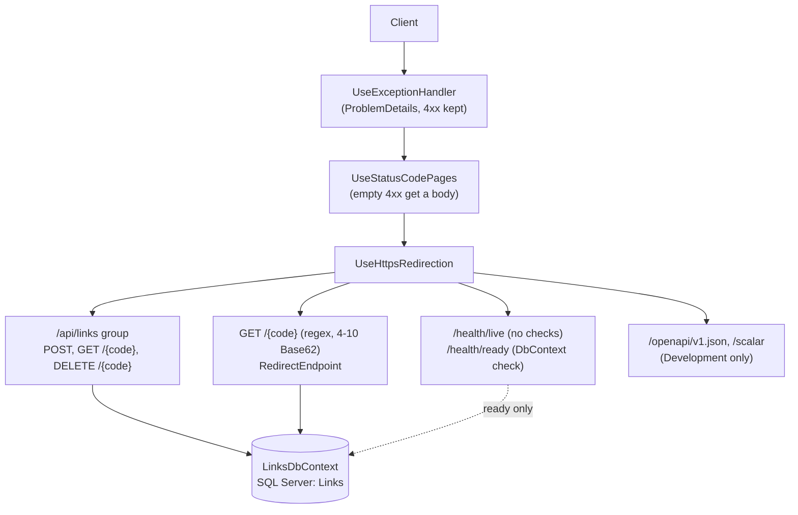
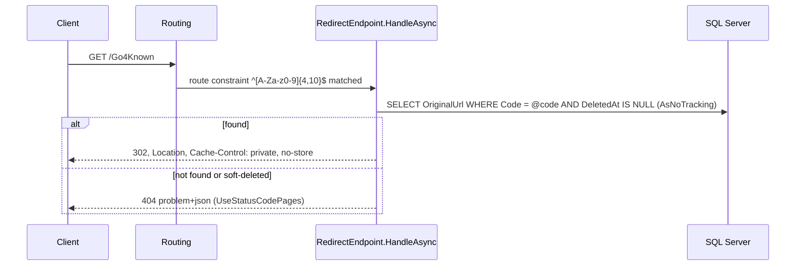
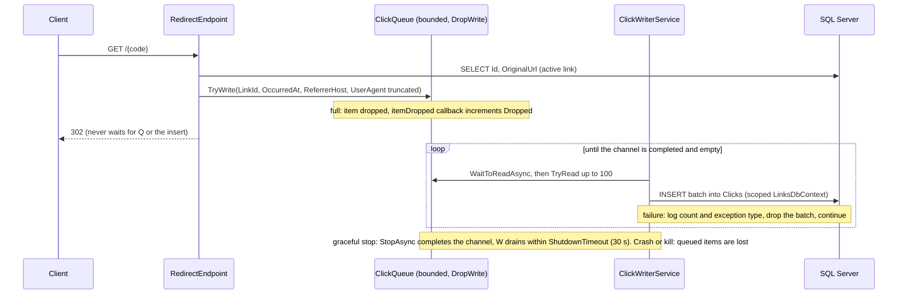
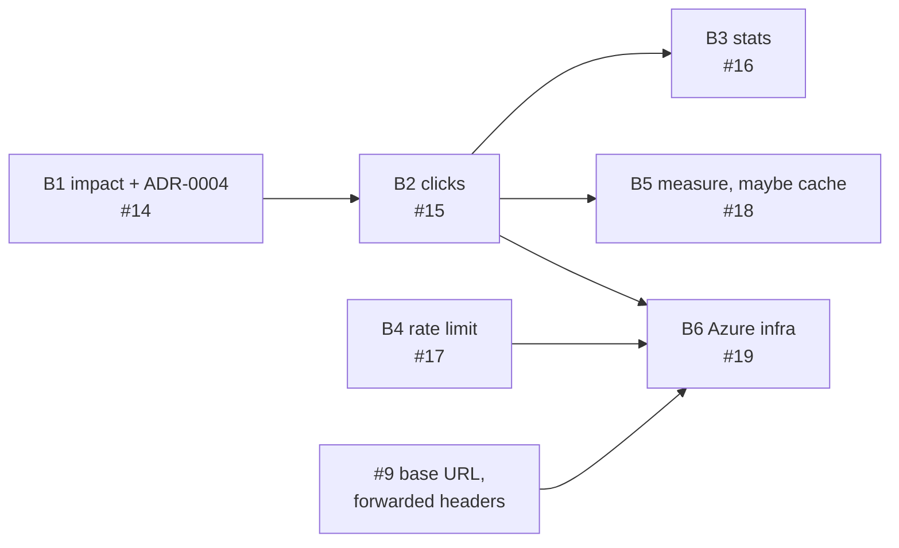

# Scenario 2: Brownfield, analytics, rate limiting and Azure on a working service

Day 2. Starting point: the Day 1 service on `main` (PR #13), 72 passing tests (47 unit, 25 integration). This document is task B1 (#14): what the Day 2 changes touch, what could break, and which test catches it, written before any Day 2 code. The analytics design is decided in [ADR-0004](../adr/0004-async-click-analytics.md).

## Requirement

Day 2 adds click analytics (B2, #15), a stats endpoint (B3, #16), rate limiting on create (B4, #17), a measured decision on a redirect cache (B5, #18), a configured public base URL (#9) and Azure infrastructure (B6, #19). "Brownfield" here means: **every change keeps the existing behaviour and the existing 72 tests green**, and adds its own tests. A change that needs an existing test edited must say why in its AI log.

## System as it is

`Program.cs` registers `TimeProvider.System`, `GenerateShortCode` and `LinksDbContext` (`EnableRetryOnFailure`), and migrates at startup in Development only. There are no hosted services and no options classes yet.

**Test infrastructure.** `SqlServerFixture` starts one real SQL Server 2022 container per test class (`IClassFixture`) and applies the migrations itself. `ApiFactory` (a `WebApplicationFactory<Program>`) is created **per test** with the fixture's connection string, a fixed `TimeProvider` (`ApiFactory.Now`) and optionally a scripted code sequence; disposing it stops the host. Tests set `EnvironmentName = "Production"` to exercise the real error pipeline and skip startup migration (`ProductionErrorPipelineTests`, and `LiveDoesNotTouchTheDatabase`, which points at an unreachable database). So every Day 2 hosted service starts and stops once per test, including against a database that does not exist.

## Impact analysis

Risk follows CLAUDE.md section 6.6. "Existing" test names were checked with `grep -rn` (AI log 007); "new" tests are to be written in the task named.

| Change | Component(s) touched | Nature | What existing behaviour could break | Risk | Existing test that protects it / new test needed |
|---|---|---|---|---|---|
| B2 `Clicks` table, queue, writer | `Data/LinksDbContext.cs` (new `Click` entity, FK to `Links`), new migration, new `Analytics/ClickQueue.cs` and `Analytics/ClickWriterService.cs`, `Program.cs` registrations | add | A model change that alters `Links` (collation, unique index) by accident; a writer that opens a connection at startup or on an empty drain breaks `LiveDoesNotTouchTheDatabase` and stops Azure SQL auto-pause; an exception escaping `ExecuteAsync` stops the host (StopHost) | high-impact (schema) | Existing: `CodeColumnUsesCaseSensitiveCollation`, `CodesDifferingOnlyByCaseAreDistinctRows`, `DuplicateCodeIsRejectedByUniqueIndex`, `LiveDoesNotTouchTheDatabase`. New (B2): `WriterSurvivesAFailedBatch`, `ShutdownDrainsPendingClicks` |
| B2 redirect enqueues | `Redirect/RedirectEndpoint.HandleAsync`: the `Select` must project `Id` as well as `OriginalUrl`; `TryWrite` only after a hit | modify | Status, `Location` or `Cache-Control` change; a miss or a deleted link records a click; enqueue blocks (`Wait` mode or `WriteAsync`) and adds latency | high-impact (part of B2) | Existing: `KnownCodeRedirectsWithFoundAndNoStore`, `UnknownCodeIsNotFoundProblem`, `SoftDeletedCodeIsNotFound`, `CodeDifferingOnlyInCaseIsNotFound`, `DeleteSoftDeletesSoGetAndRedirectAreNotFound`. New (B2): `RedirectEnqueuesClickAndWriterPersistsIt`, `RedirectStillRedirectsWhenQueueIsFull`, `MissDoesNotRecordAClick` |
| B3 stats endpoint | new `Analytics/GetStatsEndpoint.cs`, one `MapGet("/{code}/stats")` in the `/api/links` group | add | Route collision with `GET /api/links/{code}` or the redirect (two segments, so the single-segment redirect pattern cannot match) | low | Existing: `RedirectRouteDoesNotShadowApiOpenApiHealthOrScalar`, `GetReturnsLinkMetadata`. New (B3): `StatsAggregatesClicksByDayAndReferrer` (fixed `TimeProvider`), `StatsForUnknownCodeIsNotFound`, `StatsForDeletedLinkIsNotFound` |
| B4 rate limiter on create | `Program.cs` (`AddRateLimiter`, `UseRateLimiter` after `UseStatusCodePages`), `RequireRateLimiting` on the POST only, new options class validated on start | add | Tests that POST several times in one test trip a low limit (each test has its own factory and so its own limiter; the most is `DuplicateCustomAliasReturnsConflict` with 2 POSTs, so any limit of 2 or more per window is safe); default 503 without `Retry-After` (CLAUDE.md §9); redirect limited by mistake; TestServer requests probably have no `RemoteIpAddress`, so an IP key needs a constant fallback (B4 test pins it) | high-impact (rate-limit policy) | Existing: the 7 `CreateLinkEndpointTests`, `KnownCodeRedirectsWithFoundAndNoStore`. New (B4): `CreateOverLimitIsTooManyRequestsWithRetryAfter` (also asserts a problem+json body), `RedirectIsNotRateLimited` |
| B5 redirect cache (only if measured) | `RedirectEndpoint` (lookup through HybridCache L1), `DeleteLinkEndpoint` (explicit invalidation: it uses `ExecuteUpdateAsync`, so no tracked entity signals the change) | modify | A deleted link keeps redirecting from cache; case-insensitive cache keys merge `abc` and `ABC`; the cached value must carry `Id` for click recording | low (per #18) | Existing: `DeleteSoftDeletesSoGetAndRedirectAreNotFound`, `CodeDifferingOnlyInCaseIsNotFound`. New (B5, if added): `DeletedLinkStopsRedirectingWhenCached` |
| #9 base URL, forwarded headers | `CreateLinkEndpoint` and `GetLinkEndpoint` (`shortUrl` from `httpRequest.Scheme`/`Host`), new `PublicUrl` options (`BaseUrl`, `TrustForwardedHeaders`), `AllowedHosts` in `appsettings*.json`, `UseForwardedHeaders` first in `Program.cs`, **`tests/UrlShortener.IntegrationTests/ApiFactory.cs`** (must supply the option) | modify | Widest blast radius: a `ValidateOnStart` option that `ApiFactory` does not set fails host startup for **all 25 integration tests**; restricting `AllowedHosts` outside Development breaks the Production-environment tests (TestServer's host is `localhost`, as `CreatesLinkWithGeneratedCode` shows); forwarded headers trusted from any source let clients spoof the IP the rate limiter partitions on | high-impact (trust boundary) | Existing: `CreatesLinkWithGeneratedCode` (asserts `shortUrl` is `http://localhost/{code}`), `GetReturnsLinkMetadata`, the 3 `ProductionErrorPipelineTests`, `LiveDoesNotTouchTheDatabase`. New (#9): `ShortUrlIgnoresClientHostHeader` |
| B6 infra, production migrations | new `azure.yaml`, `infra/*.bicep`; a migration step outside the app (today `Program.cs` migrates in Development only and `SqlServerFixture` migrates on its own); `Microsoft.Data.SqlClient.Extensions.Azure` for `Active Directory Default` | add | Production starts on an unmigrated database (no `Clicks` table: every batch fails while redirects still 302); a DB-touching liveness probe or a polling writer burns the free offer; secrets in config | high-impact (infra) | Existing: `LiveDoesNotTouchTheDatabase`, `ReadyIsHealthyWhenDatabaseIsReachable`. New (B6): `az bicep build` / `azd provision --preview` clean, live curl evidence; migration option (bundle or idempotent script) decided in B6, not here |

Cross-cutting: timing assertions ("click row within N ms", drain) run in CI on `ubuntu-latest` with Testcontainers. Poll up to a generous bound (for example every 50 ms up to 5 s) instead of a fixed sleep.

## Data flow after Day 2

The database is touched only when a batch exists: an idle writer waits on the channel, not on a timer.

## Sequencing and dependencies

B4 does not depend on B2 and can run in parallel. #9 should land with or before B4's IP partitioning and must land before B6. B6 is last because it deploys everything else.

## Open questions for the engineer

**Decisions (engineer, 2026-10-10):** 1 → (b) referrer host + truncated user agent; 2 → no IP stored; 3 → per-IP fixed window with a constant fallback, proxy caveat stated in ADR-0005; 4 → 404; 5 → 10,000; 6 → batch 100, no timer; 7 → no retention, stated as a known gap; 8 → `datetimeoffset`, plan corrected in B2. ADR-0004 is accepted on that basis. The questions are kept below as they were asked, so the reasoning stays visible.

In priority order. **Question 1 must be answered before B2 starts**, because it fixes the schema.

1. **Analytics shape.** Options: (a) `OccurredAt` only; (b) plus referrer host and user agent truncated to 256 characters; (c) plus UA family parsing; (d) plus country (needs a GeoIP database). **Recommendation: (b).** It serves `topReferrers[5]` in the planned stats shape and needs no package; keeping the raw (truncated) UA leaves family parsing possible later. The research lists UA family and country as optional ([domain notes](../research/notes/URL%20shortener%20assignment%20validation/domain_design_security.md), Q7).
2. **IP handling in `Clicks`.** Options: none / truncated (/24 IPv4, /48 IPv6) / salted hash with a rotating salt. **Recommendation: none.** No Day 2 feature needs it, and under CJEU *Breyer* (C-582/14) a dynamic IP is personal data "for a website publisher that has legal means to identify the visitor with the ISP's help" (research notes, Q7). That point rests on **secondary legal commentary** in the research (PARTIALLY VERIFIED), not on a legal opinion. Truncated or hashed IP stays a future option. Separately, B4 may use the client IP **in memory** as a rate-limit partition key; it is never stored.
3. **Rate-limit partition before #9 lands.** Options: one global fixed window / per-IP fixed window / per-IP only after `UseForwardedHeaders`. **Recommendation:** per-IP with a constant fallback when `RemoteIpAddress` is null, stating the caveat that behind Container Apps ingress every client looks like the proxy until #9 configures forwarded headers (so in effect a global limit; #9 made it an explicit `TrustForwardedHeaders` switch that clears the known-network lists, since the ingress addresses are not fixed). Values go in ADR-0005.
4. **Stats for a deleted link.** Issue #16 already says 404 for unknown or deleted. **Recommendation: confirm 404**, consistent with `GET /api/links/{code}` and the redirect; the rows stay in `Clicks`.
5. **Queue capacity.** **Recommendation: 10,000** (about 11 MB worst case). Reasoning in ADR-0004.
6. **Batch size and flush.** **Recommendation:** up to 100 rows per insert and no timer: the writer inserts whatever is queued as soon as it wakes. Reasoning in ADR-0004.
7. **Retention.** **Recommendation: none for the prototype**, stated as a known gap. `Clicks` grows without bound; a scheduled delete of rows older than N days is the obvious next step.
8. **`OccurredAt` type.** `docs/plan.md` says `datetime2`; `Links` uses `datetimeoffset` (changed in G2, AI log 002). **Recommendation: `datetimeoffset`**, and correct the plan text in B2.

## Execution

Everything above was written before any Day 2 code (B1, PR #20). The tasks then ran in the sequence shown, each through the same loop as Day 1: issue → branch → fresh subagent → coordinator review and gates → reviews on high-impact work → PR → engineer sign-off and merge ([`CLAUDE.md`](../../CLAUDE.md) §6). B3/B4 and B5/#9 ran in parallel worktrees. Once the service was deployed, three more tasks came out of checking it live.

| Task | Issue → PR | What changed | Tests after (unit + integration) | Reviews | AI log |
|---|---|---|---|---|---|
| B1 | #14 → #20 | This impact analysis and ADR-0004; 8 decisions answered by the engineer | 47 + 25 (no code) | coordinator review | [007](../ai-log/007-brownfield-impact.md) |
| B2 | #15 → #22 | `Clicks` table and migration, `ClickQueue` (bounded, `DropWrite`), `ClickWriterService`; the redirect enqueues | 47 + 30 | security + code | [008](../ai-log/008-click-analytics.md) |
| B3 | #16 → #23 | `GET /api/links/{code}/stats` (total, 7-day series, top referrers) | 47 + 35 | security + code | [009](../ai-log/009-stats.md) |
| B4 | #17 → #24 | Per-IP fixed window on create, 429 + `Retry-After`, ADR-0005 | 47 + 34 (parallel with B3) | security + code | [010](../ai-log/010-rate-limit.md) |
| B5 | #18 → #26 | k6 measurement; decision: no cache | 47 + 39 | coordinator review | [012](../ai-log/012-perf-measure.md) |
| #9 | #9 → #27 | `PublicUrl:BaseUrl` for `shortUrl`; opt-in forwarded headers | 47 + 44 | security + code | [011](../ai-log/011-public-base-url.md) |
| B6 | #19, #25 → #29 | `azd` + Bicep (Container Apps, Azure SQL free offer, Entra-only, managed identity), Dockerfile, startup migration switch, ADR-0006 | 47 + 51 | security + code | [013](../ai-log/013-azure-infra.md) |
| B7 | #28 → #30 | OpenTelemetry to Application Insights; dropped-clicks metric | 47 + 54 | security + code | [014](../ai-log/014-telemetry.md) |
| Deploy fixes | #31 → #32 | Region, auto-pause delay, circular image lookup (found by the first `azd up`) | 47 + 54 | coordinator, live deploy | [015](../ai-log/015-sql-autopause-default.md) |
| Trace sampling | #33 → #34 | Keep every trace, so a `traceId` a client quotes can be found (found live) | 47 + 54 | coordinator, live re-check | [016](../ai-log/016-trace-sampling.md) |
| Azure perf | (small) → #35 | B5's first cache trigger measured on Azure; decision stands | 47 + 54 | coordinator review | [017](../ai-log/017-azure-perf.md) |

Existing tests stayed green throughout, and none was edited: from the Day 1 merge (PR #13) to the end of Day 2, `git diff --stat` on `tests/` shows 699 lines added and none removed.

## Validation

**Risks named in the impact analysis, and what caught each:**

| Risk (impact table above) | Check | Result |
|---|---|---|
| Analytics slows or breaks the redirect | `RedirectStillRedirectsWhenQueueIsFull`; k6 with the writer running | 302 with the queue full; every click stored at about 1,100 redirects/s ([TESTING.md](../TESTING.md#performance)) |
| Clicks lost at shutdown | `ShutdownDrainsPendingClicks` | The design as briefed stored **0 of 250**; after the fix, 250 of 250 ([AI log 008](../ai-log/008-click-analytics.md)) |
| A writer exception stops the host | `WriterSurvivesAFailedBatch` | The host keeps running ([AI log 008](../ai-log/008-click-analytics.md)) |
| Rate limiter defaults (503, no `Retry-After`) | `RateLimitingTests` | 429 + `Retry-After`; redirect, get and delete not limited ([AI log 010](../ai-log/010-rate-limit.md)) |
| Behind the Container Apps proxy every client looks the same | `PublicUrlTests` with a non-loopback peer | Forwarded headers only when switched on, with known-network lists cleared ([AI log 011](../ai-log/011-public-base-url.md)) |
| Probes keep the free-offer database awake | `LiveDoesNotTouchTheDatabase`; liveness probe only, on `/health/live` | Database auto-pauses; cold start measured at 22.1 s ([TESTING.md](../TESTING.md#on-azure-the-b6-trigger-check)) |
| A migration runs while the old image still serves | Code review of B6 | Rule added: migrations must be backward-compatible with the previous image ([ADR-0006](../adr/0006-azure-hosting-and-migrations.md)) |

**Live on Azure** (centralus): create 201, redirect 302 + `private, no-store`, stats counting the click, readiness through the managed identity ([AI log 015](../ai-log/015-sql-autopause-default.md)); telemetry checks 7 of 8 passing, 1 not observed ([AI log 014](../ai-log/014-telemetry.md)); trace ids from 429s found 3 of 3 after #33 ([AI log 016](../ai-log/016-trace-sampling.md)).

**What the reviews and live checks caught** beyond the authors' own tests: the rollout window (B6), an HTTPS-redirect ordering that spent two rate-limit permits per `http://` POST (B4), raw-string validation of the base URL (#9), three deploy failures that lint and preview passed (#31), and sampled-out trace ids (#33). Each is in the summary's [review table](../ENGINEERING_SUMMARY.md#what-the-reviews-caught).
