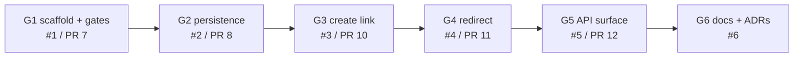

# Scenario 1: Greenfield, the core create/redirect service

Day 1. Starting point: an empty repository and an approved plan ([`docs/plan.md`](../plan.md)). End point: a runnable service ([`SETUP.md`](../SETUP.md)) with decisions recorded in [ADR-0001](../adr/0001-stack-and-database.md), [ADR-0002](../adr/0002-short-codes-and-collation.md) and [ADR-0003](../adr/0003-redirect-semantics.md).

## Requirement

The brief asks for a "core create/redirect service". I normalised that into: create a short link for an absolute http/https URL (generated 7-character code or a custom alias), redirect `GET /{code}` to the destination, and, so a reviewer can inspect and discover it, read and soft-delete a link, health probes, OpenAPI with a Scalar UI, and ProblemDetails for every error. The full API surface and data model are in [`docs/plan.md`](../plan.md). Two ambiguities were **deliberately deferred to Day 3** rather than guessed: what "expire" means (default TTL, hard versus soft delete, 404 versus 410; expired links currently still redirect) and what "safe" means (private IPs, self-loops, reputation checks, reserved words beyond a small list). They become the ambiguous scenario (tasks A1/A2 in the plan). Analytics and rate limiting are Day 2 (brownfield).

## Decomposition

Six tasks, each a GitHub issue with intent, constraints, runnable acceptance criteria and a risk level. Each was small enough to review as one PR.

| Task | Issue / PR | Intent | Depends on | Risk | AI log |
|---|---|---|---|---|---|
| G1 Solution scaffold, quality gates, agent settings, CI | #1 / #7 | .NET 10 solution where every later task is held to the same bar | G0 (repo scaffold) | high-impact (agent settings, CI) | [001](../ai-log/001-solution-scaffold.md) |
| G2 Persistence | #2 / #8 | EF Core model, migration, compose file, Testcontainers fixture; prove `abc` and `ABC` are distinct on real SQL Server | G1 | high-impact (schema) | [002](../ai-log/002-persistence.md) |
| G3 Create link | #3 / #10 | Short-code generator, `POST /api/links`, URL validation, retry on conflict, custom alias | G2 | high-impact (destination-URL validation) | [003](../ai-log/003-create-link.md) |
| G4 Redirect | #4 / #11 | `GET /{code}`: 302, `no-store`, 404 | G3 | low | [004](../ai-log/004-redirect.md) |
| G5 API surface | #5 / #12 | Get and delete, health, OpenAPI/Scalar, global ProblemDetails, safe logging | G4 | low at review; PR marked high-impact after the CI fix changed agent settings | [005](../ai-log/005-api-surface.md) |
| G6 Docs | #6 / this PR | SETUP, this document, ADRs 0001 to 0003 | G5 | low | [006](../ai-log/006-day1-docs.md) |

The order is a chain because each task builds on the previous behaviour; tests, not file ownership, are what make the hand-offs safe.

## Execution

Every task followed the same loop (rules in [`CLAUDE.md`](../../CLAUDE.md) section 6):

1. **Issue** with acceptance criteria written first.
2. **Fresh subagent** per issue (G2 to G5 were Opus 5.5 subagents; G1 was done by the coordinating session). The coordinator's prompt carried the issue, the hard rules, and the list of checks to paste.
3. **Coordinator review** before commit: re-read the whole diff and independently re-run the gates. The outcome of each review is a "Coordinator review" table in the task's AI log.
4. **Gates**: `dotnet build` (warnings are errors), `dotnet format --verify-no-changes`, `dotnet test`, `dotnet list package --vulnerable --include-transitive`.
5. **High-impact tasks** additionally got `/security-review` and a fresh-context `/code-review` (G2, G3).
6. **PR** with a walkthrough and the pasted check output, CI, then **engineer sign-off and merge**. Claude never merged.

TDD was applied where the plan says it matters: collation and uniqueness (G2), short-code generation and URL validation (G3), redirect status and headers (G4). Everything else had tests added after, at integration level.

### What was generated, edited, rejected: six concrete examples

Each is recorded with real output in the AI log named.

| # | What happened | Outcome | Source |
|---|---|---|---|
| 1 | The first `dotnet build` of the stock .NET 10 template failed the NuGet audit: transitive `Microsoft.OpenApi` 2.0.0 carries GHSA-v5pm-xwqc-g5wc (high). | **Edited**: pinned `Microsoft.OpenApi 2.12.2` centrally (first patched is 2.7.5). The gate was green from the first commit instead of being waived. | [001](../ai-log/001-solution-scaffold.md) |
| 2 | Stop hook ran `dotnet build \| tail`; without `pipefail` a failed build returned `tail`'s exit code and passed the gate. | **Edited**: `set -o pipefail` added to the hook. A `Read(docs/brief/**)` deny rule was also **rejected**: the brief is secret from the repo, not from the agent. | [001](../ai-log/001-solution-scaffold.md) |
| 3 | TDD red run: entity and unique index written with no collation. `CodesDifferingOnlyByCaseAreDistinctRows` failed with `Cannot insert duplicate key row ... The duplicate key value is (ABC)`, and the column read back `SQL_Latin1_General_CP1_CI_AS`. | **Generated, then edited**: `.UseCollation("Latin1_General_100_CS_AS")` added, the uncommitted migration deleted and regenerated (one clean initial migration). A proposal to redo it with `migrations remove` was **rejected** (needs a live database). | [002](../ai-log/002-persistence.md), [ADR-0002](../adr/0002-short-codes-and-collation.md) |
| 4 | Fresh-context `/code-review` of G3: non-ASCII URLs passed validation, but Kestrel rejects them in a `Location` header, so G4 would have returned 500 for an accepted link. | **Edited**: validator now requires printable ASCII; 3 test cases added (`café`, an IDN host, NBSP). Same review also found a collision test that could not detect an off-by-one in the attempt count: **fixed**. | [003](../ai-log/003-create-link.md) |
| 5 | Agent proposed `TypedResults.NotFound()` for the redirect miss. The red run showed a 404 with no body and no `Content-Type` under `AddProblemDetails()` alone. | **Edited** to `Problem(404)`; then in G5 reverted to `NotFound()` once global `UseStatusCodePages()` made the body correct everywhere. A route constraint using `:alpha` was **rejected** (codes contain digits). | [004](../ai-log/004-redirect.md), [005](../ai-log/005-api-surface.md) |
| 6 | CI failed on CA1873 in the log calls; the local build was clean. A first diagnosis ("Release-only") and a first fix (an `IsEnabled` guard) were both wrong: CI had resolved SDK 10.0.401 while the local SDK was 10.0.101, and the newer SDK has stricter analyzers. | **Edited**: host computed into a local before the log call; `global.json` pins the SDK and `ci.yml` installs from it. The wrong diagnosis was corrected in `CLAUDE.md` section 9. | [005](../ai-log/005-api-surface.md) |

Smaller coordinator decisions are in each log: for example G5's `DELETE` as one `ExecuteUpdateAsync` instead of load-and-save (accepted: concurrent deletes cannot both return 204), and G2's missing-connection-string finding (code review: the failure surfaced as a vague SqlClient error deep in `MigrateAsync`; an explicit `InvalidOperationException` was added).

## Validation

### Evidence

Counts and results are as recorded in the AI logs and PR bodies at the end of G5; re-run the commands to confirm on your machine.

| Gate | Command | Latest recorded result |
|---|---|---|
| Build, warnings are errors | `dotnet build -c Release` | 0 warnings, 0 errors |
| Formatting | `dotnet format --verify-no-changes` | exit 0 |
| Tests | `dotnet test` | 47 unit + 25 integration passed, 0 failed (72) |
| Vulnerable packages | `dotnet list package --vulnerable --include-transitive` | none in all three projects |
| CI | [`ci.yml`](../../.github/workflows/ci.yml) | restore, format, Release build, vulnerable check, tests with coverage; SDK from `global.json`. Failed twice on PR #12 (example 6 below), fixed before merge |
| Agent cannot read secrets | `Read .env` with a dummy file present | `File is in a directory that is denied by your permission settings` (G1). The deny list does not cover Bash `cat`; protection is also "no secrets in the repo" (G2 gotcha) |
| Live behaviour | curl walkthrough in [AI log 005](../ai-log/005-api-surface.md) | 201, 200, 302 + `Cache-Control: private, no-store`, 204, 404 problem+json, health live and ready 200 |

Test counts per PR (merged state):

| PR | Unit | Integration |
|---|---|---|
| #7 G1 | 0 | 0 |
| #8 G2 | 0 | 3 |
| #10 G3 | 47 | 10 |
| #11 G4 | 47 | 15 |
| #12 G5 | 47 | 25 |

### Review tools on high-impact PRs

| PR | `/security-review` | Fresh-context `/code-review` | Outcome |
|---|---|---|---|
| #7 G1 | not applicable (no application code); settings reviewed manually, deny rule tested | skipped (no application code) | Settings reviewed manually; engineer sign-off is in the PR |
| #8 G2 | no findings (noted: compose publishes port 1433 on all interfaces, a dev convenience) | 1 finding, fixed | Missing connection string now fails with a clear message |
| #10 G3 | no HIGH/MEDIUM findings; candidates rejected with reasons in the log | 6 findings: 2 fixed, 3 deferred to #5, 1 became new issue #9 (public base URL / `AllowedHosts` / forwarded headers before deploy) | Two of the three items deferred to #5 were done in G5 (Production pipeline test, ProblemDetails for malformed JSON); the shared-factory suggestion was not. #9 is Day 2 |
| #12 G5 | not run: judged low-impact at review time | not run | Marked high-impact afterwards because the CI fix changed agent settings |

### Mutation checks the agents performed

A passing test only means something if it fails when the behaviour breaks. Each was applied temporarily, shown failing, then reverted.

| Task | Mutation | Test that failed |
|---|---|---|
| G3 | `MaxGeneratedCodeAttempts` set to 1 | `RetriesWithNewCodeWhenGeneratedCodeCollides` (log shows 1 failed, 8 passed) |
| G3 | Unconditional `UseExceptionHandler` | the malformed-JSON test failed with 500 (per PR #10) |
| G4 | Removed `&& l.DeletedAt == null` | `SoftDeletedCodeIsNotFound` (302 instead of 404) |
| G5 | `/health/live` predicate `_ => false` changed to `_ => true` | `LiveDoesNotTouchTheDatabase` |
| G5 | Log message given the full destination URL | `CreateLogsCodeAndHostButNotUrl`, on the positive assertion and (second mutation) the negative one |

Not done: `EnableSensitiveDataLogging` was not tried as a mutation (stated in AI log 005). Expiry is not enforced yet, by design.

## What a reviewer can verify in 5 minutes

1. `dotnet test` (Docker running): expect 47 unit and 25 integration tests passed. First run pulls the SQL Server image (about 1.5 GB), so allow longer.
2. `grep -n "Latin1_General_100_CS_AS" -r src/UrlShortener.Api/Data src/UrlShortener.Api/Migrations`: the collation is in the mapping and in the generated migration. Then read "Red 2" in [AI log 002](../ai-log/002-persistence.md) for the failing run without it.
3. Follow [`SETUP.md`](../SETUP.md) up to the curl walkthrough: `curl -i http://localhost:5078/$CODE` shows `302`, `Location` and `Cache-Control: private, no-store`; after `DELETE`, the same call is `404` `application/problem+json`.
4. `curl -i http://localhost:5078/health/live` still returns 200 with the database stopped (`docker compose stop`), while `/health/ready` does not. (The live test uses an unreachable DB in Production; this is the manual equivalent.)
5. Skim the "Coordinator review" tables at the bottom of AI logs [003](../ai-log/003-create-link.md) and [005](../ai-log/005-api-surface.md) to see what was accepted, edited and deferred, and why.
